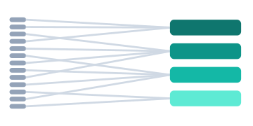
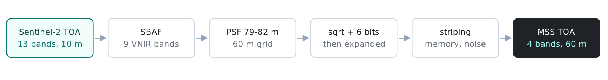
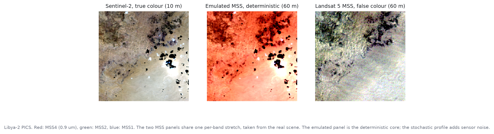
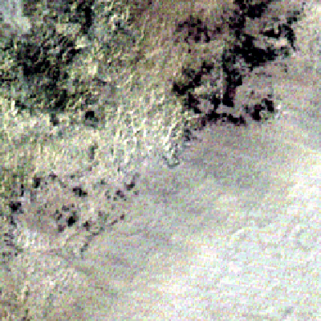
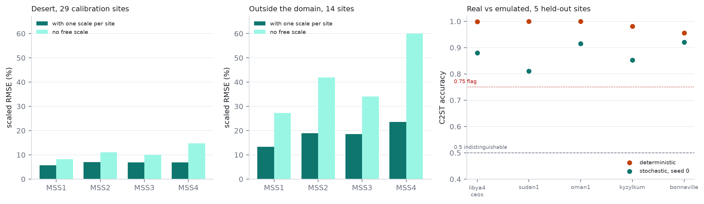
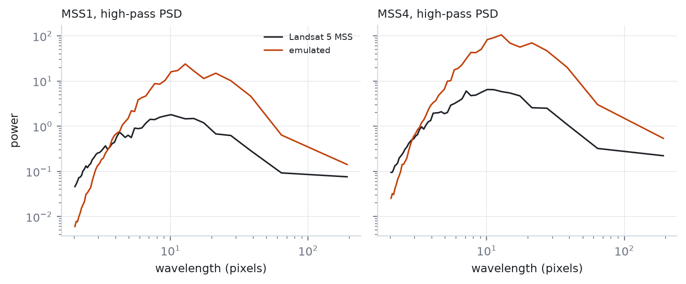

<p align="center">
  
</p>

<h1 align="center">satharmony</h1>

<p align="center">Sentinel-2 in, Landsat MSS out. Same scene, 1980s sensor.</p>

<p align="center">
  <a href="https://github.com/JulioContrerasH/satharmony/actions/workflows/tests.yml"></a>
  
  
  <a href="LICENSE"></a>
</p>

> PyPI still serves **0.1.13**. The version documented here is **0.2.0**, waiting for its
> TestPyPI check.

## What it does

satharmony turns a Sentinel-2 TOA scene into what Landsat 5 MSS would have recorded:
four bands, 60 m pixels, 6-bit radiometry, detector striping and sensor noise.

<p align="center"></p>

- **13 bands to 4.** An SBAF mixes nine S2 VNIR bands into MSS1-MSS4, plus a water-vapour term for MSS4.
- **10 m to 60 m.** A Gaussian PSF of 79-82 m, then centred averaging on the 60 m grid.
- **TOA in, TOA out.** Reflectance in [0, 1]. No atmospheric correction and no surface reflectance.
- **Deterministic or stochastic.** The same seed gives the same bytes. The stochastic profile adds striping, memory effect and noise.

What it is not: a cloud mask, a super-resolution model, or a replacement for real MSS scenes.

## Install

```bash
pip install satharmony

# GeoTIFF reading (rasterio)
pip install "satharmony[io]"

# C2ST, ECC alignment (scikit-learn, opencv)
pip install "satharmony[calib]"
```

Python 3.10 to 3.13. The CI matrix runs all four.

## Quickstart

```python
import numpy as np
from satharmony import PipelineConfig, emulate_s2

s2 = np.load("scene_s2.npy").astype(np.float32)   # (13, H, W), TOA 0-1
config = PipelineConfig.from_profile("mss5_esa_gtc_v2")
mss, factor = emulate_s2(s2, config=config, seed=42)

print(mss.shape)    # (4, H // 6, W // 6)
print(mss.dtype)    # float32, TOA 0-1
```

Raster files go through the CLI:

```bash
satharmony emulate scene_s2.tif -o mss.npy --profile mss5_esa_gtc_v2 --seed 42
satharmony metrics mss.npy reference_mss.npy --c2st --mask valid.npy
```

## Sensors

The four MSS bands and the 6-bit quantization are common to Landsat 1-5. The
spectral response, the IFOV and the radiometric constants are not, so each
sensor needs its own measured profile.

| Sensor | Status | Bank | Fit / held out | In-sample | Held out | Outside domain |
|---|---|---|---|---|---|---|
| L5_MSS | calibrated | CEOS PICS | 29 / 5 | 8.2-11.0 % | 6.5-13.6 % | 13.4-23.6 % |
| L4_MSS | calibrated | CEOS PICS | 11 / 2 | 6.3-11.7 % | 9.4-12.5 % | 13.9-22.3 % |
| L1_MSS | experimental | archive | 15 / 4 | 8.5-10.8 % | 3.5-4.4 % | not measurable |
| L2_MSS | experimental | archive | 18 / 6 | 9.3-10.3 % | 7.6-11.2 % | not measurable |
| L3_MSS | experimental | archive | 6 / 0 | 14.8-16.1 % | - | not measurable |

Numbers are per-band relative RMSE, median across sites, without any per-site
rescale. With a free per-site factor (which isolates spectral shape from a
brightness offset) L5 is 5.7-7.0 %, L1 6.1-8.1 % and L2 7.2-8.0 %.

L4 and L5 are `calibrated`: both carry the four measurements (inside, held out,
outside the domain and C2ST). L4 reaches 13.9-22.3 % outside and 0.929 C2ST,
with two held-out deserts.

L1-L3 are `experimental`. Their outside-domain test cannot be measured with the
current bank: the Landsat 1-3 scene is 1973-1983 and the S2 composite is 2015+,
over forest, water and wetland, so the surface changed between the two dates.
Only 1-2 of the 6-9 clear windows pass the 15 % stability filter, and the
geometry is not the cause (median shift below one pixel). Landsat 1-3 carried no
TM, so there is no same-second reference to align against. The bank, every scene
id and the shift measurement are listed in the manifest committed with the
notes.

The 49 CEOS PICS were chosen for surface stability, not for having an early
Landsat scene: with a clear window, only 6 have an L1 scene, 3 an L2 and 1 an
L3. L1-L3 are therefore fitted on an auxiliary bank built the other way round,
from the archive: every scene of the platform is listed, and the dry, flat,
low-cloud ones become sites. With Tier 2 included the archive holds 173k (L1),
365k (L2) and 157k (L3) scenes, so the limit was the tier and the site filter,
not the archive. A sensor without a
profile raises `SensorNotCalibrated` instead of borrowing L5 numbers. The
extension is specced in `specs/features/001-multi-sensor-mss/`.

```bash
satharmony emulate scene_s2.tif -o mss.npy --sensor L5_MSS --seed 42
satharmony emulate scene_s2.tif -o mss.npy --sensor random --seed 42
```

`random` samples uniformly over the calibrated sensors, so the same seed gives
the same sensor and the same bytes. For augmentation:

```python
from satharmony.emulators.s2_to_mss import emulate_any

mss, factor, sensor = emulate_any(s2, sensor="random", seed=42)
```

## Example

Libya-2, a calibration site. Left: Sentinel-2 true colour. Middle: emulated MSS. Right: the
real Landsat 5 scene. The two MSS panels share one stretch, taken from the real scene.

<p align="center"></p>

<p align="center"></p>

The GIF blinks between emulated and real. The emulated panel is the deterministic core; the
real 1987 scene still carries its own sensor noise.

## Profiles

| Profile | MSS1 | MSS2 | MSS3 | MSS4 | gamma | What it is |
|---|---:|---:|---:|---:|---:|---|
| `mss5_esa_gtc_v1` | 0.956 | 0.933 | 0.867 | 0.933 | 0.112 | Five CEOS PICS. Frozen: it trained the G4 cloud model. |
| `mss5_esa_gtc_v2` | 0.966 | 0.936 | 0.907 | 0.933 | 0.112 | 29 calibration PICS. B4 frozen at v1. |
| `legacy_0_1_13` | 0.600 | 0.580 | 0.600 | 0.850 | 0.112 | Bit-for-bit reproduction of 0.1.13. |

v2 is fitted on 29 calibration sites: the index has 35, one wet Uyuni scene is
removed and five deserts are held out. Fourteen forest, water, crop and wetland sites are
reserved for validation. The 29-site fit gives gamma 0.14 and MSS4 0.942; both stay at the
v1 values because the gas term is still a hypothesis, and a frozen B4 keeps the comparison
honest.

## Validation

### Radiometry

RMSE over all pixels, relative to the mean of the reference band. "Scaled" applies one
multiplicative factor per site and band, fitted in-sample: it is the best case, not what a
user gets.

| Domain | Sites | Scaled RMSE | Raw RMSE |
|---|---:|---:|---:|
| Desert and salt flats | 29 | 5.7-7.0 % | 8.2-14.7 % |
| Forest, water, crops, wetland | 14 | 13.4-23.6 % | 27.2-60.0 % |

<p align="center"></p>

Outside the calibration domain the profile is not a correction. The SBAF cannot absorb
vegetation, water or atmosphere, and no per-band scale fixes it. That is a limit of the
method, written in the profile under `validity`.

### Real vs emulated

The classifier two-sample test (C2ST) trains a logistic regression to tell real from
emulated pixels; 0.5 means indistinguishable. On the five held-out deserts:

| Mode | Median | Range |
|---|---:|---:|
| Deterministic | 0.999 | 0.956-1.000 |
| Stochastic, seed 0 | 0.884 | 0.810-0.918 |

The emulator is still distinguishable. With 62 500 pixels per site and a residual bias near
0.02, a per-pixel classifier separates the two. The number is reported, not hidden.

### Spatial

The PSF (79-82 m), the 60 m sampling and the 474 m detector period are checked against
five PICS with radial PSDs and a striping metric.

<p align="center"></p>

The FWHM of an edge is **not** measured: the PICS are homogeneous and have no slanted
edges. The PSF is set by specification, not recovered from data.

### What is not validated

- **Clouds on real MSS.** The U-Net baseline is trained on pseudo-MSS from CloudSEN12 and
  scores 0.518 mIoU on its pseudo-test; OmniCloudMask scores 0.722 with 10 m input. That is a
  reproducible baseline, not a validated mask on real MSS.
- **Human labels.** 40 chips are prepared, none annotated. There is no kappa yet.
- **Independent reproduction.** Nobody outside this machine has rebuilt the profile from the
  wheel.
- **Gas in MSS3 and BRDF/SZA.** The O2-A term is computed with 6SV but off by default. The
  PICS span 13.5 degrees of solar zenith and the scale absorbs it; there is no BRDF
  correction.

## Limits

- S2A/B/C to MSS on Landsat 5 only. MSS 1-4, TM and ETM+ are out of scope.
- TOA reflectance only.
- A desert correction: it does not extrapolate to vegetation, water or clouds.
- One profile per sensor family, not per scene. Aerosol and water vapour are not measured
  per acquisition.

## Command line

```text
satharmony emulate INPUT -o OUTPUT [--profile NAME] [--seed N]
satharmony align REFERENCE MOVING [--max-shift PX] [--no-ecc]
satharmony metrics PREDICTION OBSERVATION [--c2st] [--mask MASK.npy] [--seed N]
satharmony fit MANIFEST.csv -o PROFILE.json [--name NAME] [--n-boot N]
satharmony verify MANIFEST.csv [--no-hashes]
```

`metrics` prints SAM, RMSE and bias; `--c2st` adds the classifier score and `--mask` drops
pixels outside a boolean mask. `fit` reads `s2_mss` rows from a manifest; `verify` checks
every file and its SHA-256. The bundled `manifests/manifest_178.csv` pins 178 MSS/TM pairs
with their SHA-256. The shipped profile's sun-elevation distribution comes from
`profiles/measurements/sun_elevation_canonical.json` (all 3,027 aligned scenes).

## Input contract

- **S2**: `(13, H, W)`, band order B1, B2, B3, B4, B5, B6, B7, B8, B9, B10, B11, B12, B8A,
  TOA reflectance in [0, 1].
- **MSS**: `(4, H, W)`, B1-B4, TOA in [0, 1].
- `emulate_s2` rejects values above 2 or below -0.01: that is almost always DN. The CLI
  reads GeoTIFF only with the `io` extra.
- Labels use the CloudSEN12 encoding: 0 clear, 1 thick cloud, 2 thin cloud, 3 shadow.

## Reproduce the numbers

The scripts read the PICS tree at `/data/databases/CLOUD_MSS/MSS_S2/pics`, which is not
shipped. Their outputs are committed under `docs/validation/`.

```bash
python scripts/make_profile_v2.py        # rebuild the v2 JSON
python scripts/c2st_v2.py                # C2ST on the five held-out deserts
python scripts/desert_v2_error.py        # desert RMSE, scaled and raw
python scripts/validate_v2_outside.py    # the 14 validation sites
```

`docs/make_readme_assets.py` rebuilds the figures in this page.

## License

MIT.
